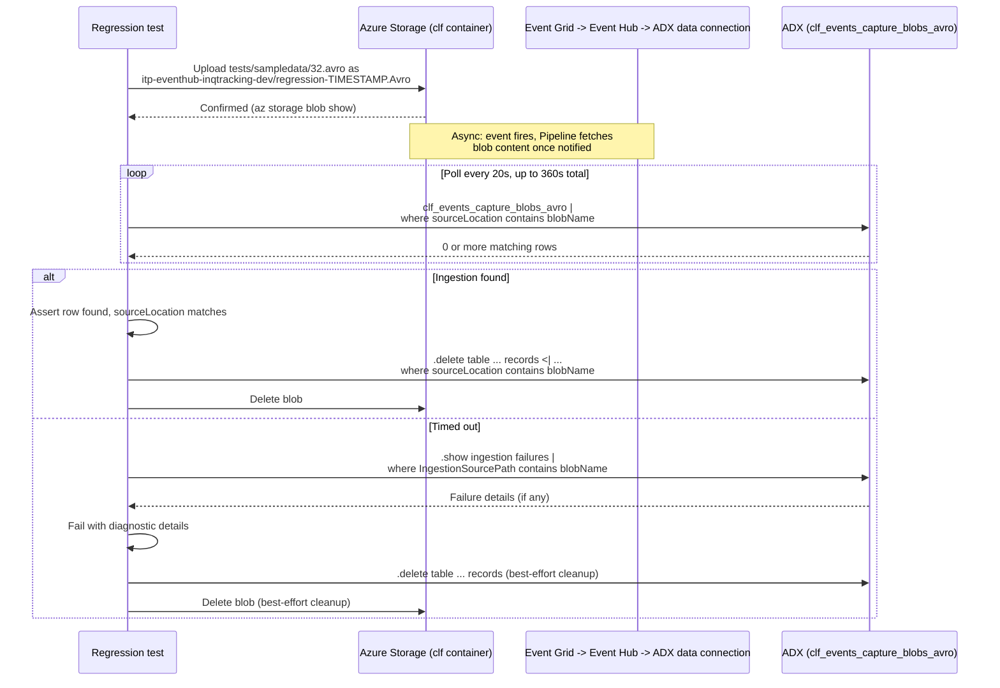

# End-to-end ingestion flow: Blob → Event Grid → Event Hub → ADX

This document explains the actual data-plane flow the infrastructure in
[infra/](/C:/Users/karr/myprojects/ingestazureblobtoadx/infra) implements -
how a blob landing in storage ends up as queryable rows in Azure Data
Explorer (ADX) - and how the end-to-end regression test verifies it. For the
CI/CD *pipeline* job graph (what runs when a PR is opened, merged, or an
environment is promoted/destroyed), see
[pipeline-architecture.md](/C:/Users/karr/myprojects/ingestazureblobtoadx/docs/pipeline-architecture.md).

## Production data flow

```mermaid
---
id: 7a3e2f1c-9d4b-4e6a-8c5f-1b2d3e4f5a6b
---
flowchart LR
    Upload["Producer uploads blob\ncontainer: clf\npath: itp-eventhub-inqtracking-dev/*.Avro"] --> Storage[("Azure Storage\nstitpeventcapture")]

    Storage -- "Microsoft.Storage.BlobCreated /\nBlobDeleted event" --> SystemTopic["Event Grid System Topic\nclfevhcaptureeventtopic"]

    SystemTopic --> Subscription{"Event Subscription\nclfevhcapturesubscription\nfilter: subjectBeginsWith\n'.../clf/blobs/itp-eventhub-inqtracking-dev'\n+ subjectEndsWith 'Avro'"}

    Subscription -- "delivered via miitpegdev identity\n(Azure Event Hubs Data Sender)" --> EventHub[("Event Hub\nitpevhdev /\nclf-evh-capture-blob-events")]

    EventHub -- "consumer group\nitpadxevhcaptureblobeventsconsumer" --> DataConnection["ADX Data Connection\nitp-evg-adx-connection\n(kind: EventGridWithManagedIdentity)"]

    DataConnection -. "fetches blob content via\nmiitpadxdev identity\n(Storage Blob Data Reader)" .-> Storage

    DataConnection -- "ingest (AVRO format)\nmapping: clf_events_capture_blobs_avro_mapping\nbatched: 2 min / 100 items / 100 MB" --> RawTable[("clf_events_capture_blobs_avro\n(clf-event-capture db)")]

    RawTable -- "update policy ->\nDecodeAvroToJsonEventBody()" --> JsonTable[("clf_events_capture_blobs_json")]

    classDef store fill:#E8F8F5,stroke:#117A65,color:#1A1A1A
    classDef identity fill:#FDEBD0,stroke:#D68910,color:#1A1A1A
    class Storage,EventHub,RawTable,JsonTable store
    class Subscription identity
```

### Step-by-step

1. **Blob upload** - a producer (an upstream Event Hub Capture job, or in
   regression tests, the test itself) writes an Avro file to the `clf`
   container under the `itp-eventhub-inqtracking-dev/` prefix with a
   `.Avro` suffix, matching the event subscription's subject filter (see
   [infra/modules/eventGrid.bicep](/C:/Users/karr/myprojects/ingestazureblobtoadx/infra/modules/eventGrid.bicep)).
2. **Event Grid System Topic** (`clfevhcaptureeventtopic`) watches the
   storage account for `Microsoft.Storage.BlobCreated`/`BlobDeleted` events.
3. **Event Subscription** (`clfevhcapturesubscription`) filters those events
   down to ones whose subject matches the configured prefix/suffix, then
   delivers the matching event (metadata only - not the blob's bytes) to an
   Event Hub, authenticating with the `miitpegdev` managed identity, which
   holds the **Azure Event Hubs Data Sender** role on the Event Hub
   namespace.
4. **Event Hub** (`itpevhdev` / `clf-evh-capture-blob-events`) buffers the
   notification. ADX reads it via a dedicated consumer group
   (`itpadxevhcaptureblobeventsconsumer`), separate from `$Default`.
5. **ADX Data Connection** (`itp-evg-adx-connection`, kind
   `EventGridWithManagedIdentity`, defined in
   [infra/modules/kusto.bicep](/C:/Users/karr/myprojects/ingestazureblobtoadx/infra/modules/kusto.bicep))
   consumes the notification from the Event Hub, then - using the
   `miitpadxdev` managed identity, which holds **Storage Blob Data Reader**
   on the storage account - reads the actual blob content back from storage.
6. **Ingestion** parses that content as Avro (`dataFormat: AVRO`) using the
   `clf_events_capture_blobs_avro_mapping` ingestion mapping, and writes the
   rows into the `clf_events_capture_blobs_avro` table in the
   `clf-event-capture` database. This is batched per the ingestion batching
   policy (`MaximumBatchingTimeSpan: 00:02:00`, `MaximumNumberOfItems: 100`,
   `MaximumRawDataSizeMB: 100`) - set in
   [adx/scripts/clf-events_capture_ingestion_tables.kql](/C:/Users/karr/myprojects/ingestazureblobtoadx/adx/scripts/clf-events_capture_ingestion_tables.kql) -
   so there can be up to a ~2-minute delay between the blob landing and rows
   appearing in the table.
7. **Update policy** - every row written to `clf_events_capture_blobs_avro`
   triggers the `DecodeAvroToJsonEventBody()` function (also defined in that
   `.kql` script), which decodes the Avro-captured `Body` field into JSON
   and writes the result into the derived `clf_events_capture_blobs_json`
   table.

The entire ADX schema (both tables, the mapping, the transform function, the
update policy, and the batching policy) is deployed declaratively from that
one `.kql` script via a `Microsoft.Kusto/clusters/databases/scripts`
resource in `kusto.bicep` - see the
["ADX (Kusto) schema management"](/C:/Users/karr/myprojects/ingestazureblobtoadx/README.md#adx-kusto-schema-management)
section of the README for how that's kept in sync.

## How the regression test verifies this end-to-end

[tests/e2e/Regression.Tests.ps1](/C:/Users/karr/myprojects/ingestazureblobtoadx/tests/e2e/Regression.Tests.ps1)
includes a functional test that drives a real blob through this entire
pipeline and confirms it actually lands in ADX - not just that the ARM
resources exist.

Key design points:

- **Uses a real sample file**, not placeholder content -
  [tests/sampledata/32.avro](/C:/Users/karr/myprojects/ingestazureblobtoadx/tests/sampledata/32.avro)
  is an actual Event-Hub-Capture-format Avro file, so it parses successfully
  under the `clf_events_capture_blobs_avro_mapping` ingestion mapping. An
  earlier version of this test wrote placeholder text content named with a
  `.Avro` extension, which Kusto rejected (`BadRequest_InvalidBlob: wrong
  magic in header`).
- **Doesn't delete the blob until ingestion is confirmed** - deleting it
  immediately after upload (as an earlier version of this test did) races
  the ingestion batching window and reliably fails with
  `Download_SourceNotFound`, since Kusto hasn't yet fetched the blob by the
  time it's deleted.
- **Polls rather than waiting a fixed delay**, since ingestion latency
  depends on the batching policy and current queue depth.
- **Verifies via the `sourceLocation` column**, which the ingestion mapping
  populates with the ingested blob's URI (via the `SourceLocation`
  transform), so the test can confirm the row came from *this specific*
  test run's blob rather than any other data in the table.
- **Surfaces `.show ingestion failures` on timeout**, scoped to the test's
  own blob path, so a real pipeline break (e.g. a broken mapping, missing
  RBAC, or a bad blob) is diagnosable directly from the test failure
  message instead of just "no rows found".
- **Cleans up in a `try`/`finally`**, independently of whether ingestion
  succeeded, timed out, or the assertions failed - so repeated or broken
  test runs never accumulate orphaned blobs or ADX rows. Both the blob
  deletion and the ADX record deletion
  (`.delete table ... records <| ...`) are wrapped individually so one
  failing doesn't skip the other, and failures are logged as warnings
  rather than silently swallowed.
- **Authenticates the same way as the rest of the pipeline** - via the
  Kusto REST API (`/v1/rest/query` and `/v1/rest/mgmt`), using an access
  token from the same `az login` session the self-hosted runner already
  uses for every other Azure call (see
  ["Authentication model"](/C:/Users/karr/myprojects/ingestazureblobtoadx/README.md#authentication-model-self-hosted-runner-no-service-principal)
  in the README) - no extra credentials or setup required.
