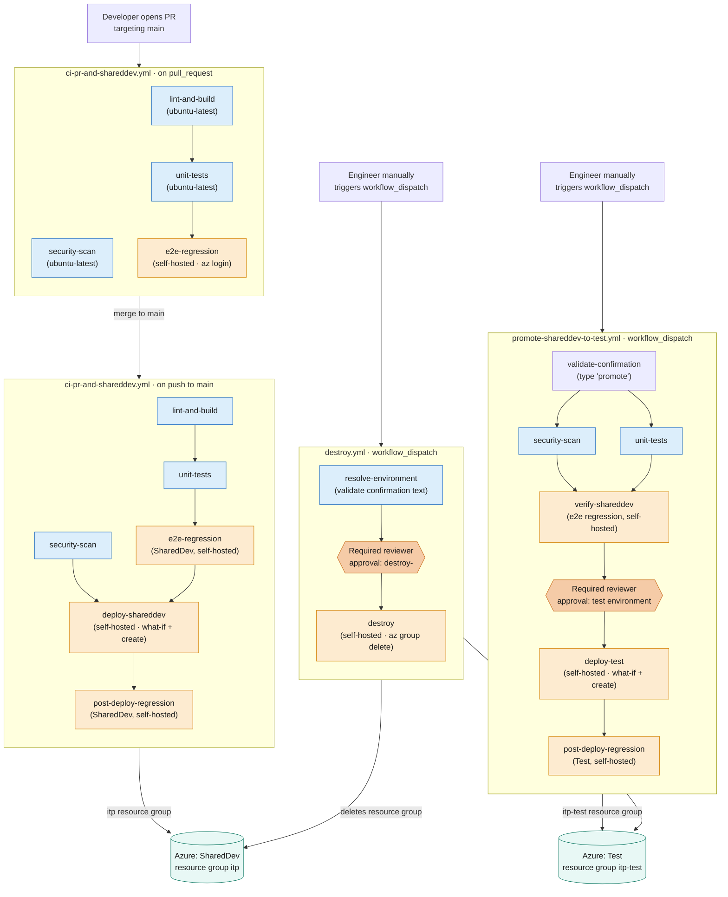

# CI/CD pipeline architecture

Diagram of the three GitHub Actions pipelines defined in
[.github/workflows/](/C:/Users/karr/myprojects/ingestazureblobtoadx/.github/workflows),
generated from the actual job graph and `runs-on` targets in that code.

- **Blue** — jobs on GitHub-hosted runners (no Azure access; safe to run
  arbitrary PR code here).
- **Orange** — jobs on the self-hosted runner, authenticated via the
  workstation's own `az login` session (see
  [README.md](/C:/Users/karr/myprojects/ingestazureblobtoadx/README.md#authentication-model-self-hosted-runner-no-service-principal)).
- **Dark-orange diamonds** — human approval gates on protected GitHub
  Environments (`test`, `destroy-shareddev`, `destroy-test`).
- **Green** — the target Azure resource groups.

